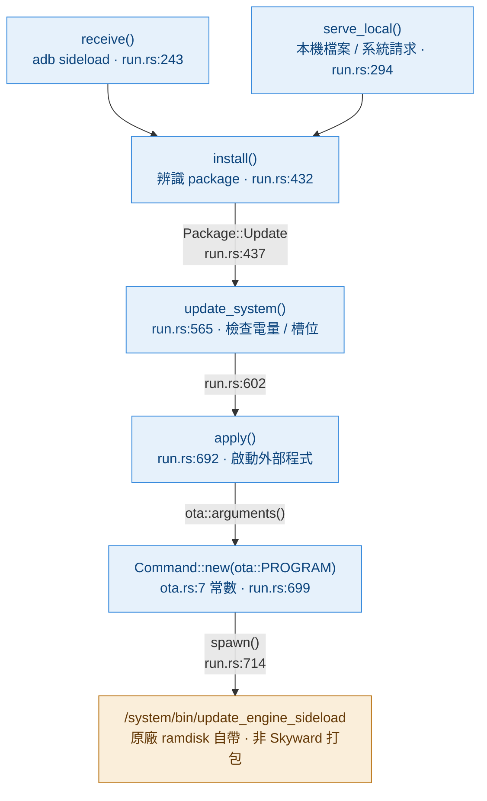

# `update_engine_sideload` 呼叫鏈

Skyward 在安裝 A/B 系統更新時，會呼叫原廠 recovery ramdisk 內的 `update_engine_sideload`。以下是完整呼叫路徑。

## 呼叫圖



蓝色节点是 Skyward 自身代码，橙色节点是外部执行档。

## 直接呼叫位置

**路徑常數** — `crates/skyward-install/src/ota.rs:7`

```rust
pub const PROGRAM: &str = "/system/bin/update_engine_sideload";
```

**真正啟動處理序** — `crates/skyward-install/src/run.rs:692-714`，位於 `apply()` 函式內：

```rust
fn apply<S>(ctx: &Context, mount: &Mount<S>, update: &Update) -> Result<i32> {
    ...
    let mut command = std::process::Command::new(ota::PROGRAM);        // 699 行
    command
        .args(ota::arguments(fuse::PACKAGE, update, status_fd))       // 701 行
        .stdin(Stdio::null())
        .stdout(Stdio::null())
        .stderr(Stdio::piped());
    ...
    let mut child = command.spawn()                                    // 714 行
        .with_context(|| format!("start {}", ota::PROGRAM))?;
```

**參數組裝** — `crates/skyward-install/src/ota.rs:11-18`：

```text
--payload=file:///sideload/package.zip
--offset=<payload_offset>
--headers=<update.properties>
--status_fd=<fd>
```

## 呼叫鏈文字版

| 步骤 | 函式 | 位置 | 说明 |
|---|---|---|---|
| 1 | `receive()` | `run.rs:243` | 接收 `adb sideload` 送来的 package |
| 1 | `serve_local()` | `run.rs:294` | 接收本机档案 / 系统要求的 package |
| 2 | `install()` | `run.rs:432` | `package::identify()` 辨识类型 |
| 3 | `update_system()` | `run.rs:437`、`565` | 仅 `Package::Update` 分支进入；检查电量、槽位、snapshot 状态 |
| 4 | `apply()` | `run.rs:602`、`692` | 挂载 `/metadata` 前后准备，启动外部程序并追踪进度 |
| 5 | `Command::new(...)` | `run.rs:699` | 使用绝对路径启动，不依赖 `PATH` |
| 6 | `.spawn()` | `run.rs:714` | 产生子进程，读取 status pipe 与 stderr |

## 兩個注意點

1. **執行檔不是 Skyward 打包進去的。** 全專案只有 `ota.rs:7` 的常數定義與 `run.rs:699` 的 `Command::new` 兩處提到它。`skyward-pack` 沒有 `rd.add` 它，`tools/` 裡也沒有；它來自 `stock/recovery_stock.img` 原有的 ramdisk（`system/bin/update_engine_sideload`，2699088 bytes，`0755`），打包時被原樣保留。`skyward-waffle.img` 與 `skyward-waffle-tools-test.img` 都含有它。

2. **`adb sideload` 本身不等於呼叫它。** `skyward-install/src/adb.rs` 是 Skyward 自己實作的 adb 協定，用來接收 package 並掛到 `/sideload/package.zip`。只有當辨識出 package 是 A/B 更新包時，才會轉交給 `update_engine_sideload` 寫入分割區；img、zip script、system 等類型走 Skyward 自己的流程，不會啟動它。

---

分析過程未修改任何程式碼。
