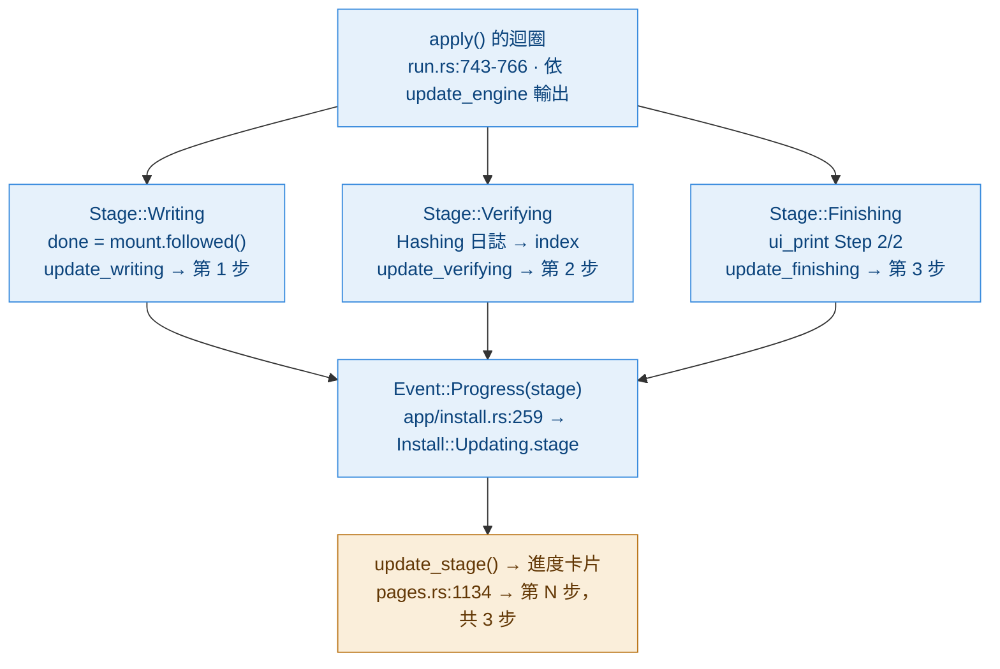

# `Stage` 如何控制安裝步驟

程式裡**沒有 `step = 1/2/3` 這種變數**。步驟編號是隱含在 `Stage` 的列舉變體（variant）裡，再由 UI 的文案表翻譯成「第 N 步，共 3 步」。

## 流程圖



蓝色是安装器与 UI 状态代码，橙色是最终画面上的步骤文字。

## 1. `Stage` 的定义

位于 `crates/skyward-install/src/lib.rs:139-167`。对 A/B 系统更新来说，真正会用到的只有三个变体：

```rust
pub enum Stage {
    Writing { done: u64, total: u64 },                              // 第 1 步
    Verifying { index: usize, count: usize, partition: String },     // 第 2 步
    Finishing,                                                      // 第 3 步
    ...
}
```

其余变体（`Flashing`、`Script`、`Signature`、`Allocating`、`Root`、`Storing` 等）是刷 img、执行脚本、安装第二系统用的，与这三步无关。

## 2. Stage 由安装器产生

在 `crates/skyward-install/src/run.rs` 的 `apply()` 里，也就是启动 `update_engine_sideload` 的那个函式：

```rust
739  let mut stage = Stage::Writing { done: 0, total };
740  ctx.send(Event::Progress(stage.clone()));       // 先送第 1 步

743  loop {
        // 读取 update_engine 的 status fd 与 stderr
745      Status::Step(2)      → finishing = true
747      Log::Partition(_)    → partitions += 1
749      Log::Hashing { .. }  → verifying = Some((index, partition))

754      let now = if finishing {
755          Stage::Finishing
756      } else if let Some((index, partition)) = &verifying {
757          Stage::Verifying { index, count: partitions.max(index + 1), ... }
758      } else {
759          Stage::Writing { done: mount.followed(), total }
760      };

761      let moved_on = discriminant(&now) != discriminant(&stage);
762      if now != stage && (moved_on || 超过 PROGRESS_EVERY) {
763          stage = now;
764          ctx.send(Event::Progress(stage.clone()));
765      }
     }
```

要点：

- `Writing` 的进度 `done` 来自 `mount.followed()`，也就是 FUSE 挂载 `/sideload/package.zip` 已被读取的字节数。
- `Verifying` 由 `Hashing partition N (name)` 日志触发，`index` 是第几个分割区，`count` 来自 `PartitionInfo` 日志数量。
- `Finishing` 由 `ui_print Step 2/2` 触发。
- `std::mem::discriminant` 用来判断「换步骤」：换变体时立刻发送，没换则每 `PROGRESS_EVERY` 才送一次，避免刷屏。

## 3. UI 接收并保存

`crates/skyward-ui/src/app/install.rs:237`：

```rust
Event::Installing { version } => Install::Updating { version, stage: None, ... }
```

`install.rs:259-266`：

```rust
Event::Progress(stage) => match install {
    Install::Updating { stage: shown, .. } => *shown = Some(stage),
    ...
}
```

## 4. 渲染时映射成「第几步」

`crates/skyward-ui/src/pages.rs:1129-1141` 在画进度卡片时调用 `update_stage()`：

```rust
let (detail, done) = update_stage(l, stage.as_ref());
widgets::progress_card(..., &detail, done);
```

`pages.rs:887-905` 的 `update_stage()` 是变体到文案的对应表：

| Stage 变体 | 文案 key | 显示文字 |
|---|---|---|
| `Writing` | `update_writing` | 第 1 步，共 3 步：寫入新系統 {p}% |
| `Verifying` | `update_verifying` | 第 2 步，共 3 步：驗證 {partition}（{n}/{count}） |
| `Finishing` | `update_finishing` | 第 3 步，共 3 步：完成安裝 |

进度条也在这里决定：`Writing` 用 `done/total`，`Verifying` 用 `index/count`，`Finishing` 是 `None`（不确定进度）。

## 5. 一个容易误解的点

`update_engine` 自己只报 `Step 1/2` 和 `Step 2/2`，但 Skyward 的 UI 把它拆成了 3 步：

- `Writing` 和 `Verifying` 其实都发生在 `update_engine` 的 Step 1 期间（先写分割区，再读回校验）
- `Finishing` 才对应 `update_engine` 的 Step 2

所以「共 3 步」是 Skyward 自己重新定义、并写死在语言文件里的，不是 `update_engine` 报上来的。

## 想修改时

- 改文案 / 步数文字：`crates/skyward-ui/locales/zh-Hant.toml:707-709`，不用动 Rust
- 改何时切到第 2 / 第 3 步：`crates/skyward-install/src/run.rs:743-766` 的判定逻辑
- 改进度条算法：`crates/skyward-ui/src/pages.rs:887-905` 的 `update_stage()`

---

整理过程未修改任何程式码。
